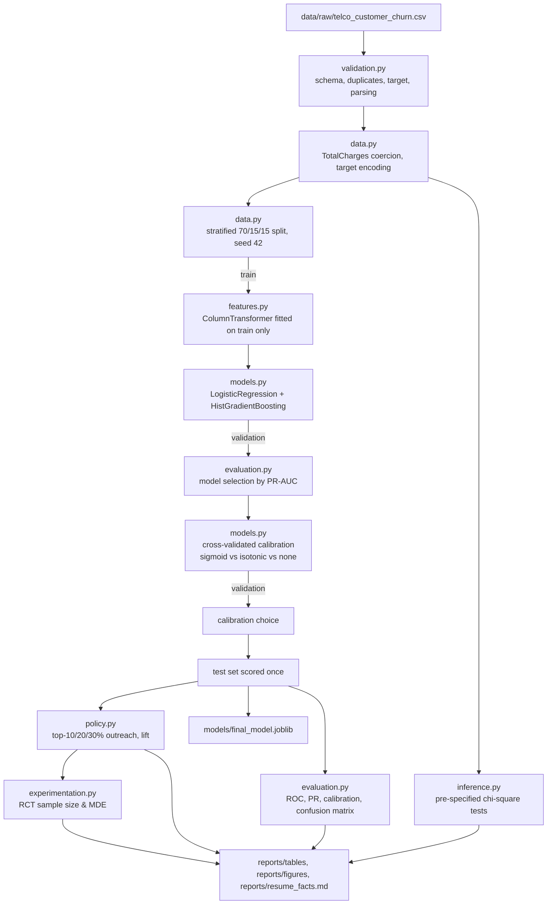

# ChurnGuard

A customer-retention decision engine built on the IBM Telco Customer Churn dataset. It goes
from raw data to a defensible operating policy, and then states plainly what the data
*cannot* answer — with a power analysis sizing the randomized experiment that could.

Every number in this README was produced by `python scripts/run_pipeline.py` and can be
traced to a file under `reports/`. Nothing is illustrative or estimated.

## Business Problem

A telecom retention team has finite capacity: it can call, discount, or otherwise engage
only a fraction of the customer base in any given cycle. Ranking customers by churn risk is
therefore not an accuracy contest — it is a triage problem under a budget constraint. The
project answers four questions:

1. **Who is most likely to churn?** — a ranking problem.
2. **Are the predicted probabilities trustworthy?** — a calibration problem, distinct from ranking.
3. **Under a fixed outreach budget (10% / 20% / 30% of customers), how many actual churners does risk-ranked targeting reach versus random outreach?** — an operating-policy problem.
4. **How large would a randomized retention experiment need to be to prove an intervention works?** — a causal-design problem this dataset cannot answer directly.

## Dataset

IBM's **fictional** Telco Customer Churn sample dataset (`IBM/telco-customer-churn-on-icp4d`,
`data/Telco-Customer-Churn.csv`), vendored unchanged at `data/raw/telco_customer_churn.csv`.

| Property | Value |
| --- | --- |
| Rows | 7,043 |
| Raw columns | 21 |
| Model features | 19 (after dropping `customerID` and the target) |
| Target | `Churn` (Yes/No), encoded to `churn` ∈ {0, 1} |
| Churn prevalence | 26.5% (1,869 churners) |

The data is observational: it records what happened, with no record of any retention action
taken. That constraint shapes every claim below.

## Architecture



## Data Quality

`reports/validation_report.json` is generated on every run. Findings from the actual data:

| Check | Result |
| --- | --- |
| Schema | All 21 expected columns present, none unexpected |
| Row count | 7,043 (as expected) |
| Duplicate `customerID` | 0 |
| Target values | Exactly `{No, Yes}` |
| Missing values (raw) | None reported by pandas |
| `TotalCharges` parsing | **11 values fail numeric parsing** — blank strings, all belonging to customers with `tenure == 0` |

The `TotalCharges` issue is the substantive one: the column arrives as `object` dtype because
of those blanks. It is coerced with `errors="coerce"` and the resulting NaNs are imputed
*inside* the pipeline, so the imputation statistic is learned from training rows only. A test
asserts the blanks belong exclusively to zero-tenure customers.

## Modeling

Two intentionally different models, both wrapped in a `Pipeline` so preprocessing is fitted
per-split and never leaks:

- **Baseline — `LogisticRegression`** (L2, `C=1.0`): median imputation → `StandardScaler` →
  `OneHotEncoder(handle_unknown="ignore")`. Interpretable, well-calibrated by construction.
- **Challenger — `HistGradientBoostingClassifier`** (`learning_rate=0.05`, `max_iter=300`,
  `max_leaf_nodes=15`, `min_samples_leaf=40`, early stopping): most-frequent imputation →
  `OrdinalEncoder(handle_unknown="use_encoded_value", unknown_value=-1)` with native
  categorical support. Captures interactions the linear model cannot.

Hyperparameters are fixed at conservative defaults rather than searched. In a time-boxed
project, an aggressive search over a 1,057-row validation split buys little beyond
validation-set overfitting.

**Leakage controls.** `customerID` is dropped before any model sees the data (and asserted
absent in tests); the target is dropped from the feature frame; every transformer is fitted
on the training split only; the test split is scored exactly once, in `evaluate_on_test`,
after model *and* calibration choices are final.

## Evaluation

### Model selection (validation set, n = 1,057)

| Model | PR-AUC | ROC-AUC | Brier | Log loss | Accuracy | Precision | Recall | F1 |
| --- | --- | --- | --- | --- | --- | --- | --- | --- |
| LogisticRegression | 0.628 | 0.830 | 0.1408 | 0.4358 | 0.794 | 0.639 | 0.516 | 0.571 |
| **HistGradientBoosting** | **0.643** | **0.833** | **0.1392** | **0.4312** | 0.800 | 0.670 | 0.491 | 0.567 |

Selection criterion is **PR-AUC**, not accuracy: the positive class is a 26.5% minority and
the business use is ranking under a budget. Note that the challenger wins on PR-AUC and
Brier while *losing* on F1 — picking by accuracy or F1 would have selected differently for
reasons irrelevant to the actual decision. The margin between the two models is small
(0.014 PR-AUC on ~1,057 rows); the honest reading is that the challenger is modestly better
here, not decisively so.

### Final test-set performance (n = 1,057, scored once)

| Metric | Value |
| --- | --- |
| ROC-AUC | 0.855 |
| PR-AUC | 0.670 |
| Brier score | 0.1324 |
| Log loss | 0.4058 |
| Accuracy | 0.803 |
| Precision @ 0.5 | 0.671 |
| Recall @ 0.5 | 0.504 |
| F1 @ 0.5 | 0.576 |

Test churn prevalence is 26.5%, so a PR-AUC of 0.670 is roughly 2.5× the no-skill baseline
of 0.265. Source: `reports/tables/test_metrics.csv`.

Figures: `reports/figures/roc_curve.png`, `precision_recall_curve.png`,
`confusion_matrix.png`, `calibration_curve.png`.

## Calibration

Ranking quality and probability quality are different problems. A model can order customers
perfectly and still report probabilities that are systematically wrong — which matters here,
because a calibrated probability is what lets the business multiply risk by customer value.

Calibration is fitted with 5-fold cross-validation on the **training** split
(`CalibratedClassifierCV`), then compared against the uncalibrated model on the
**validation** split. The test set plays no part in the choice.

| Variant | Validation Brier | Log loss | PR-AUC | ROC-AUC |
| --- | --- | --- | --- | --- |
| Uncalibrated | 0.13919 | 0.4312 | 0.643 | 0.833 |
| **Sigmoid (selected)** | **0.13809** | 0.4274 | 0.639 | 0.836 |
| Isotonic | 0.13819 | 0.4296 | 0.641 | 0.836 |

**Honest reading: calibration helped, but marginally.** Sigmoid improved the validation Brier
score by 0.0011 (0.8% relative) and log loss by 0.0039. This is a small gain, and it comes
with a slight *reduction* in PR-AUC (0.643 → 0.639) — calibration is a monotone-ish
transform aimed at probability accuracy, not ranking, so this trade is expected. The
gradient-boosting model was already close to well-calibrated (see
`reports/figures/calibration_curve.png`), which is why there was little room to improve. The
project would report the same table if calibration had hurt.

## Retention Policy

Each test-set customer receives a calibrated churn probability and is ranked highest-risk
first. Source: `reports/tables/retention_policy.csv`, plot:
`reports/figures/cumulative_gains.png`.

| Capacity | Contacted | Churners captured | Capture rate | Precision among contacted | Lift vs random |
| --- | --- | --- | --- | --- | --- |
| Top 10% | 106 | 80 of 280 | 28.6% | 75.5% | **2.85×** |
| Top 20% | 212 | 143 of 280 | 51.1% | 67.5% | **2.55×** |
| Top 30% | 318 | 185 of 280 | 66.1% | 58.2% | **2.20×** |

Reading the top-20% row: contacting 212 customers at random would be expected to reach about
56 churners; risk-ranked targeting reaches 143 — roughly half of all churners in the test set
from one fifth of the contacts. Precision decays as capacity grows (75.5% → 58.2%), which is
the expected shape and is exactly the information a capacity-planning conversation needs.

**These are retrospective prioritization metrics on held-out data. They measure how well the
model ranks customers who did churn. They do not measure, and cannot measure, how many
churners would be *saved* by contacting them.**

## Experiment Design

The dataset has no randomized treatment assignment, so the project builds a **prospective**
design module instead of estimating an effect that isn't identifiable here.

Design question: *if the company randomizes a retention offer within the high-risk population
a top-20% policy would contact, how many customers per arm are needed?* The baseline is the
**observed churn rate of 67.5% among those contacted customers** — a measured quantity from
`retention_policy.csv`, not an assumption. Tests are two-sided two-proportion comparisons at
α = 0.05, using the normal approximation with Cohen's h (`statsmodels.stats.power`).

### Required sample size per arm

| Assumed absolute reduction | Implied treatment churn | 80% power | 90% power |
| --- | --- | --- | --- |
| 2 pp (67.5% → 65.5%) | 65.5% | 8,747 / arm | 11,710 / arm |
| 3 pp (67.5% → 64.5%) | 64.5% | 3,915 / arm | 5,241 / arm |
| 5 pp (67.5% → 62.5%) | 62.5% | 1,428 / arm | 1,912 / arm |

**The reductions above are assumptions for sizing, not measured effects.** No intervention has
been run.

### Minimum detectable effect for a given sample size

| Per arm | MDE @ 80% power | MDE @ 90% power |
| --- | --- | --- |
| 1,000 | 6.0 pp | 7.0 pp |
| 2,500 | 3.8 pp | 4.4 pp |
| 5,000 | 2.7 pp | 3.1 pp |
| 10,000 | 1.9 pp | 2.2 pp |
| 25,000 | 1.2 pp | 1.4 pp |

The practical consequence: a pilot of 1,000 per arm can only detect a churn reduction of
about 6 percentage points or larger. If the retention team believes a realistic offer moves
churn by 2–3 points, a pilot that size will very likely come back "not significant" while
telling you nothing about whether the offer works. That is a design decision worth making
before spending the budget, not after. Full grid: `reports/tables/experiment_design.csv`.

## Association Tests

Three pre-specified chi-square tests of independence (fixed in `config.py` before results were
inspected), on the full dataset. Source: `reports/tables/chi_square_tests.csv`.

| Comparison | χ² | df | p-value | Cramér's V |
| --- | --- | --- | --- | --- |
| Churn vs Contract | 1184.6 | 2 | 5.9e-258 | 0.410 |
| Churn vs InternetService | 732.3 | 2 | 9.6e-160 | 0.322 |
| Churn vs PaperlessBilling | 258.3 | 1 | 4.1e-58 | 0.191 |

Observed churn rates by level: month-to-month 42.7% vs one-year 11.3% vs two-year 2.8%;
fiber optic 41.9% vs DSL 19.0% vs no internet 7.4%; paperless billing 33.6% vs 16.3%.

These are **associations in observational data**. Contract type is not randomly assigned —
customers who expect to stay select longer contracts — so the Contract–churn association
almost certainly reflects selection as well as any contractual lock-in effect. With n = 7,043
the p-values are effectively guaranteed to be small; Cramér's V is the more informative column.

## Key Findings

1. The calibrated gradient-boosting model achieves **test ROC-AUC 0.855 and PR-AUC 0.670**
   against a 26.5% prevalence baseline.
2. **Risk-ranked outreach at 20% capacity reaches 51.1% of test-set churners — 2.55× random
   targeting** — with 67.5% of contacted customers being actual churners.
3. **Calibration produced a small but real improvement** (validation Brier 0.13919 → 0.13809
   with sigmoid), at the cost of a slight PR-AUC decrease. The model was already close to
   calibrated.
4. Model choice changes with the metric: the challenger wins on PR-AUC and Brier but loses on
   F1. Selecting by accuracy would have optimized the wrong thing for this use case.
5. **A retention RCT on this high-risk population needs roughly 3,900 customers per arm to
   detect a 3-point churn reduction at 80% power** — an order-of-magnitude fact that should
   precede any pilot.

## What This Project Does NOT Claim

- **The data is observational.** It contains no record of any retention action, offer, or
  contact.
- **There is no treatment variable**, and none was manufactured. No synthetic intervention
  column exists anywhere in this repository.
- **No causal retention claim is made.** Nothing here estimates how much churn an
  intervention prevents, because that quantity is not identifiable from this data.
- **Policy lift is not intervention effectiveness.** "The top 20% contains 51% of churners" is
  a statement about ranking on historical outcomes. It does not imply that contacting those
  customers retains any of them — a perfectly targeted campaign with a useless offer would
  produce the same lift table and zero retained customers.
- **The chi-square results are associations, not causes.**
- **The experiment-design effect sizes are assumptions**, chosen to span a plausible range for
  sizing purposes. They are not observed effects.
- The dataset is **IBM's fictional sample**, not real customer data; absolute metric values
  should not be read as benchmarks for a real telco.

The predictive question ("who appears at high risk?") is answerable with this data. The causal
question ("does contacting them reduce churn?") requires a randomized experiment — which is
why this repository ships a power analysis instead of an effect estimate.

## Reproducing

```bash
python -m venv .venv && source .venv/bin/activate
```

```bash
pip install -r requirements.txt
```

```bash
python scripts/run_pipeline.py
```

```bash
python -m pytest
```

For development (adds the linter and installs the package itself):

```bash
pip install -e ".[dev]"
```

```bash
ruff check .
```

Optionally, re-audit every number in this README against the generated files:

```bash
python scripts/verify_readme_claims.py
```

`run_pipeline.py` is the single entry point: one invocation regenerates every table, figure,
the validation report, the model artifact, `run_summary.json`, and `reports/resume_facts.md`.
There is no hidden setup step.

**Determinism.** Repeated runs in the same environment produce byte-identical output — all 20
generated artifacts, including the PNGs and the joblib model, verified across three
consecutive runs. Across library versions the agreement is numerical rather than byte-level:
the same pipeline was run under Python 3.9 (scikit-learn 1.6.1, NumPy 1.26) and Python 3.10
(scikit-learn 1.7.2, NumPy 2.2), and every metric, policy figure, and sample size in this
README was identical, with differences confined to the last one or two digits of the raw
floats in some CSV columns.

**Environment.** Developed on Python 3.9 and verified on Python 3.10; CI runs 3.10 and 3.12.
On Python 3.9 the test suite emits 14 `PyparsingDeprecationWarning`s. These come from
matplotlib's internal font-config parser calling an older pyparsing API — no project code is
involved, and they do not appear on Python 3.10+. They are left unsuppressed rather than
filtered away.

If `data/raw/telco_customer_churn.csv` is missing, fetch it from
`https://raw.githubusercontent.com/IBM/telco-customer-churn-on-icp4d/master/data/Telco-Customer-Churn.csv`
and save it to that path; the pipeline raises a `FileNotFoundError` naming the location.

## Repository Structure

```
churnguard-retention-ml/
├── data/
│   ├── raw/telco_customer_churn.csv    # immutable source copy
│   └── processed/                      # train/validation/test splits (generated)
├── src/churnguard/
│   ├── __init__.py
│   ├── config.py           # every path, seed, and constant
│   ├── data.py             # loading, cleaning, target encoding, splitting
│   ├── validation.py       # data-quality checks -> JSON report
│   ├── features.py         # ColumnTransformer pipelines (linear + tree variants)
│   ├── models.py           # baseline, challenger, calibration wrapper
│   ├── evaluation.py       # metrics and diagnostic plots
│   ├── policy.py           # outreach policy, lift, cumulative gains
│   ├── experimentation.py  # RCT sample size and MDE
│   ├── inference.py        # pre-specified chi-square tests
│   ├── reporting.py        # generates resume_facts.md from artifacts
│   └── pipeline.py         # orchestration, leakage ordering enforced here
├── tests/                  # 37 pytest tests
├── reports/
│   ├── figures/            # ROC, PR, calibration, confusion matrix, gains
│   ├── tables/             # metrics, policy, experiment design, chi-square
│   ├── validation_report.json
│   ├── run_summary.json
│   └── resume_facts.md     # generated; only verified claims
├── models/final_model.joblib           # generated; git-ignored (see below)
├── scripts/
│   ├── run_pipeline.py            # the one reproducibility command
│   └── verify_readme_claims.py    # audits README numbers against reports/
└── .github/workflows/ci.yml
```

**What is and is not committed.** Source, tests, CI, the raw dataset, and every generated
report, table, and figure are committed — the reports are the evidence behind the numbers
above, and the ~950 KB raw CSV keeps the project reproducible offline. Two outputs are
git-ignored because they are large, derivable in about 20 seconds, and (for the model)
fragile across scikit-learn versions: `models/final_model.joblib` and the
`data/processed/*.csv` splits. Both are recreated by `python scripts/run_pipeline.py`.

## Limitations

- **Single split, no repeated evaluation.** Test metrics come from one 1,057-row split;
  differences of a percentage point or two are within noise. Repeated stratified splits or
  nested CV would give honest confidence intervals.
- **The 0.643 vs 0.628 validation PR-AUC gap is not decisive.** The baseline logistic model is
  a defensible production choice if interpretability matters more than the margin.
- **No hyperparameter search.** Fixed, conservative settings — a deliberate time-box decision,
  not a claim of optimality.
- **No cost model.** Policy metrics count churners, not dollars. A real deployment would rank
  by expected value (probability × customer value × offer cost), which can invert the ranking.
- **Static snapshot.** No temporal split or drift analysis; a production model would be
  validated on a later time period than it was trained on.
- **Threshold fixed at 0.5** for the classification metrics. The operating point should be set
  from capacity or cost, which is what the policy table exists to inform.
- **Fictional data.** Metric magnitudes reflect IBM's synthetic sample.

## Next Steps

1. **Run the experiment the design module sizes.** That is the only way to move from
   "who looks risky" to "what actually retains them."
2. **Add a cost/value layer** so outreach is prioritized by expected value rather than raw
   probability.
3. **Estimate uncertainty** — bootstrap confidence intervals on test metrics and policy lift.
4. **Add temporal validation** if timestamped data becomes available.
5. **Uplift modeling** once RCT data exists: target customers whose churn is *changeable*, not
   merely those whose churn is likely — a materially different ranking.
