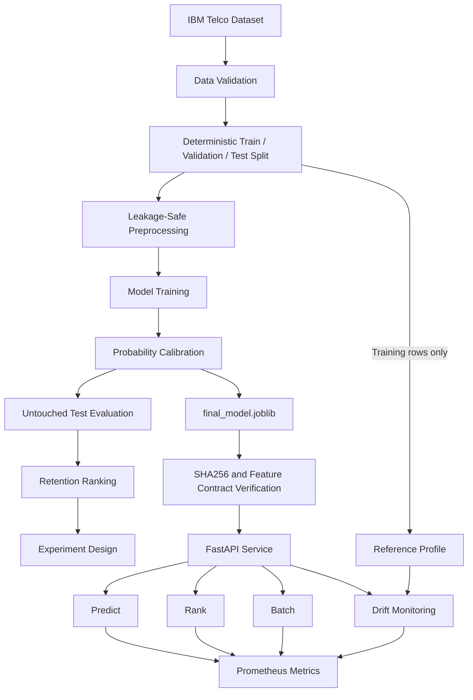

# RetentionLab — Customer Churn Prioritization

**Live Demo:** https://retentionlab-rho.vercel.app
**API Docs:** https://retentionlab-rho.vercel.app/docs
**Repository:** https://github.com/abs768/retentionlab

A retention team can only contact a fraction of its customers each cycle. RetentionLab ranks
customers by calibrated churn risk so that limited outreach goes to the people most likely to
leave, sizes the randomized experiment needed to prove an offer actually works, and serves the
model through a typed FastAPI service with drift monitoring and metrics.

It uses IBM's fictional Telco sample (7,043 customers). Every number in this README is read
back from a saved artifact by `scripts/verify_readme_claims.py`, and the project is explicit
about what the data can and cannot show: it measures who looks risky, not who would be saved.

> The Python package and model artifact keep their original internal name (`churnguard`).
> Renaming them would invalidate the frozen, checksum-verified artifact for no public benefit.

## At a Glance

| | Result | Source |
| --- | --- | --- |
| Ranking quality | Test ROC-AUC **0.855**, PR-AUC **0.670** (no-skill baseline 0.265) | `reports/tables/test_metrics.csv` |
| Outreach at 20% capacity | Reaches **51.1%** of churners, **2.55×** random targeting | `reports/tables/retention_policy.csv` |
| Experiment sizing | About **3,915 customers per arm** to detect a 3-point churn drop at 80% power | `reports/tables/experiment_design.csv` |
| Serving | 12 endpoints, checksum-verified model, drift monitoring, Prometheus metrics, 89 tests | `reports/serving_verification.json` |

## Contents

[Features](#features) · [Architecture](#architecture) · [Getting Started](#getting-started) ·
[Demo Walkthrough](#demo-walkthrough) · [Results](#dataset) · [Serving](#ml-serving-architecture) ·
[Testing](#testing) · [Deployment](#public-deployment) · [What This Project Does NOT Claim](#what-this-project-does-not-claim) ·
[Project Documents](#project-documents)

## Business Problem

A telecom retention team has finite capacity: it can call, discount, or otherwise engage
only a fraction of the customer base in any given cycle. Ranking customers by churn risk is
therefore not an accuracy contest — it is a triage problem under a budget constraint. The
project answers six questions:

1. **Who is most likely to churn?** — a ranking problem.
2. **Are the predicted probabilities trustworthy?** — a calibration problem, distinct from ranking.
3. **Under a fixed outreach budget (10% / 20% / 30% of customers), how many actual churners does risk-ranked targeting reach versus random outreach?** — an operating-policy problem.
4. **How large would a randomized retention experiment need to be to prove an intervention works?** — a causal-design problem this dataset cannot answer directly.
5. **How can the trained model be served reliably?** — a typed API, verified artifact, startup readiness, and vectorized inference.
6. **How can data drift and service health be monitored?** — training-only reference distributions and instance-local Prometheus metrics.

## Features

**Data science (`src/churnguard/`)**

- **Data validation** — schema, row count, duplicate IDs, target values and numeric parsing are checked on every run; the 11 blank `TotalCharges` values are traced to zero-tenure customers.
- **Leakage-safe modeling** — a logistic regression baseline and a HistGradientBoosting challenger, each wrapped in a `Pipeline` fitted on the training split only.
- **Selection by PR-AUC, not accuracy** — the model and calibration are chosen on the validation split; the test split is scored exactly once.
- **Probability calibration** — sigmoid and isotonic calibration compared against the uncalibrated model.
- **Capacity-based retention policy** — churners reached, precision and lift at 10%, 20% and 30% outreach capacity.
- **Experiment design** — sample size per arm and minimum detectable effect for a future randomized retention test.
- **Association tests** — three pre-specified chi-square tests with Cramér's V.

**ML engineering (`app/`)**

- **Typed API** — Pydantic schemas that reject unknown categories, negative charges and extra fields.
- **Verified model loading** — SHA256, scikit-learn version, feature contract and a smoke prediction are checked once at startup; failures turn `/ready` and scoring endpoints into 503s.
- **Scoring and ranking** — `/predict`, `/batch-predict` (up to 1,000 customers in one vectorized call) and `/rank` with a capacity fraction or top-N.
- **Drift monitoring** — PSI and categorical total variation against a training-only reference profile.
- **Observability** — six Prometheus metric families; customer payloads are never logged.
- **Landing page** — a server-rendered page whose every figure is generated from the saved artifacts, with live demos that call the real API.

## Architecture

The end-to-end flow:



The DS pipeline selects the algorithm and calibration using validation data. Test results
are retrospective evidence after selection. The serving layer loads the existing final
artifact once during lifespan startup; it never fits a model on an API request.

### Module design

The class/module design is in [`diagrams/uml_final.mmd`](diagrams/uml_final.mmd) (Mermaid; paste it
into [mermaid.live](https://mermaid.live) to render). [`diagrams/uml_draft.mmd`](diagrams/uml_draft.mmd)
shows the Phase 1 design, before the serving layer existed. Each module has one job:

| Module | Responsibility |
| --- | --- |
| `churnguard/config.py` | Every constant: paths, seed, split sizes, capacities, experiment grid |
| `churnguard/validation.py` | Raw-data checks and the validation report |
| `churnguard/data.py` | Loading, numeric coercion, target encoding, stratified three-way split (`DataSplits`) |
| `churnguard/features.py` | Feature typing and the two preprocessors (linear and tree) |
| `churnguard/models.py` | Baseline, challenger and calibrated model builders |
| `churnguard/evaluation.py` | Metrics and evaluation plots |
| `churnguard/policy.py` | Capacity-based retention policy and cumulative gains |
| `churnguard/experimentation.py` | Sample size and minimum detectable effect |
| `churnguard/inference.py` | Chi-square tests and Cramér's V |
| `churnguard/pipeline.py` | Orchestrates every stage and returns `PipelineResult` |
| `app/schemas.py` | `Customer`, `BatchRequest`, `RankRequest`, `Prediction`, `RankingResult` |
| `app/model_service.py` | `ModelService`: verified artifact loading |
| `app/inference.py` | The single customers-to-DataFrame adapter and checked scoring |
| `app/ranking.py` | Capacity selection and tie-stable ranking |
| `app/monitoring.py` | Reference profile, PSI and drift status |
| `app/metrics.py` | `ServiceMetrics`: the Prometheus registry |
| `app/landing.py` | Server-rendered landing page |
| `app/main.py` | `create_app()`: lifespan startup and routes |

## Getting Started

### Setup

Python 3.10 is the tested version (scikit-learn is pinned to 1.6.1, the version that serialized the model).

```bash
git clone https://github.com/abs768/retentionlab.git
cd retentionlab
python3.10 -m venv .venv
source .venv/bin/activate
pip install -e ".[dev]"
export OMP_NUM_THREADS=1 OPENBLAS_NUM_THREADS=1
python scripts/download_data.py        # fetches the pinned dataset and checks its SHA256
```

### Run it

```bash
python scripts/verify_model_artifact.py   # checks the frozen model before serving it
uvicorn app.main:app --host 127.0.0.1 --port 8000
```

Then open http://127.0.0.1:8000 for the landing page or http://127.0.0.1:8000/docs for the API.
To regenerate the analysis from scratch instead, see [Reproduction](#reproduction).

## Demo Walkthrough

### Main features of the landing page (`GET /`)

| Section | What a visitor can do |
| --- | --- |
| Problem and results | Read the headline metrics, all generated from the saved reports |
| Targeting | Compare churners reached at 10%, 20% and 30% outreach capacity against random outreach |
| Live prediction demo | Fill in a customer form and get a churn probability from the real `/predict` endpoint |
| Live ranking demo | Rank a sample batch with the real `/rank` endpoint and see who is selected for outreach |
| Experiment, architecture, drift, benchmark | Read how the experiment was sized and how the service is built and monitored |

### Example workflow

1. `GET /ready` confirms the model loaded and its checksum was verified.
2. `POST /predict` scores one customer.
3. `POST /rank` scores a batch and marks the top share for outreach.
4. `POST /monitor/drift` compares a recent batch against the training distribution.
5. `GET /metrics` shows request counts, errors and latency for the running instance.

### Sample output

The output below comes from running these requests against the service locally. Customer A is a
2-month, month-to-month fiber customer; B is on a two-year contract with 60 months of tenure; C is
on a one-year contract.

`GET /ready`

```json
{"status": "ready", "model_version": "churnguard-hgb-calibrated-v1", "model_loaded": true,
 "metadata_loaded": true, "checksum_verified": true}
```

`POST /predict` with the training-row example stored in `artifacts/model/model_metadata.json`

```json
{"customer_id": null, "churn_probability": 0.024077664756562235,
 "model_version": "churnguard-hgb-calibrated-v1"}
```

`POST /rank` with customers B, A, C and `"capacity_fraction": 0.34`

```json
{
  "customers": [
    {"customer_id": "A-100", "churn_probability": 0.61108068101187, "rank": 1, "selected_for_outreach": true},
    {"customer_id": "C-300", "churn_probability": 0.08798983082639246, "rank": 2, "selected_for_outreach": true},
    {"customer_id": "B-200", "churn_probability": 0.024829412603616468, "rank": 3, "selected_for_outreach": false}
  ],
  "total_customers": 3,
  "selected_count": 2
}
```

(`model_version` is omitted from each ranked row above for width.) The capacity is
`ceil(0.34 × 3) = 2`, so the two highest-risk customers are selected.

`POST /monitor/drift` with the same three customers returns `substantial_apparent_shift` for
every numeric feature, plus a warning that batches under 100 rows give unstable estimates. That is
the expected result for a tiny hand-picked batch, not a sign of real drift.

## Dataset

IBM's **fictional** Telco Customer Churn sample dataset (`IBM/telco-customer-churn-on-icp4d`,
`data/Telco-Customer-Churn.csv`), downloaded unchanged to `data/raw/telco_customer_churn.csv`.
Run `python scripts/download_data.py` to fetch a pinned upstream revision and verify SHA256.
See [dataset provenance](data/README.md): the upstream code-pattern license does not clearly
establish a separate dataset redistribution grant, so the raw CSV is excluded from the current
tracked tree. The original commit still contains it; resolve rights before publishing that history.
The root [MIT license](LICENSE) covers original ChurnGuard code, not third-party data.

| Property | Value |
| --- | --- |
| Rows | 7,043 |
| Raw columns | 21 |
| Model features | 19 (after dropping `customerID` and the target) |
| Target | `Churn` (Yes/No), encoded to `churn` ∈ {0, 1} |
| Churn prevalence | 26.5% (1,869 churners) |

The data is observational: it records what happened, with no record of any retention action
taken. That constraint shapes every claim below.

## Data Validation

`reports/validation_report.json` is generated on every run. Findings from the actual data:

| Check | Result |
| --- | --- |
| Schema | All 21 expected columns present, none unexpected |
| Row count | 7,043 (as expected) |
| Duplicate `customerID` | 0 |
| Target values | Exactly `{No, Yes}` |
| Missing values (raw) | None reported by pandas |
| `TotalCharges` parsing | **11 values fail numeric parsing** — blank strings, all belonging to customers with `tenure == 0` |

The `TotalCharges` issue is the substantive one: the column arrives as `object` dtype because
of those blanks. It is coerced with `errors="coerce"`. The logistic pipeline learns median
imputation from training rows only; the selected gradient-boosting pipeline handles numeric
NaN values natively. A test asserts the source blanks belong exclusively to zero-tenure customers.

## Modeling

Two intentionally different models, both wrapped in a `Pipeline` so preprocessing is fitted
per-split and never leaks:

- **Baseline — `LogisticRegression`** (L2, `C=1.0`): median imputation → `StandardScaler` →
  `OneHotEncoder(handle_unknown="ignore")`. Interpretable, well-calibrated by construction.
- **Challenger — `HistGradientBoostingClassifier`** (`learning_rate=0.05`, `max_iter=300`,
  `max_leaf_nodes=15`, `min_samples_leaf=40`, early stopping): most-frequent imputation →
  `OrdinalEncoder(handle_unknown="use_encoded_value", unknown_value=-1)` with native
  categorical support. Captures interactions the linear model cannot.

Hyperparameters are fixed at conservative defaults rather than searched. In a time-boxed
project, an aggressive search over a 1,057-row validation split buys little beyond
validation-set overfitting.

**Leakage controls.** `customerID` is dropped before any model sees the data (and asserted
absent in tests); the target is dropped from the feature frame; every transformer is fitted
on the training split only; the test split is scored exactly once, in `evaluate_on_test`,
after model *and* calibration choices are final.

### Model selection (validation set, n = 1,057)

| Model | PR-AUC | ROC-AUC | Brier | Log loss | Accuracy | Precision | Recall | F1 |
| --- | --- | --- | --- | --- | --- | --- | --- | --- |
| LogisticRegression | 0.628 | 0.830 | 0.1408 | 0.4358 | 0.794 | 0.639 | 0.516 | 0.571 |
| **HistGradientBoosting** | **0.643** | **0.833** | **0.1392** | **0.4312** | 0.800 | 0.670 | 0.491 | 0.567 |

Selection criterion is **PR-AUC**, not accuracy: the positive class is a 26.5% minority and
the business use is ranking under a budget. Note that the challenger wins on PR-AUC and
Brier while *losing* on F1 — picking by accuracy or F1 would have selected differently for
reasons irrelevant to the actual decision. The margin between the two models is small
(0.014 PR-AUC on ~1,057 rows); the honest reading is that the challenger is modestly better
here, not decisively so.

## Calibration

Ranking quality and probability quality are different problems. A model can order customers
perfectly and still report probabilities that are systematically wrong — which matters here,
because a calibrated probability is what lets the business multiply risk by customer value.

Calibration is fitted with 5-fold cross-validation on the **training** split
(`CalibratedClassifierCV`), then compared against the uncalibrated model on the
**validation** split. The test set plays no part in the choice.

| Variant | Validation Brier | Log loss | PR-AUC | ROC-AUC |
| --- | --- | --- | --- | --- |
| Uncalibrated | 0.13919 | 0.4312 | 0.643 | 0.833 |
| **Sigmoid (selected)** | **0.13809** | 0.4274 | 0.639 | 0.836 |
| Isotonic | 0.13819 | 0.4296 | 0.641 | 0.836 |

**Honest reading: calibration helped, but marginally.** Sigmoid improved the validation Brier
score by 0.0011 (0.8% relative) and log loss by 0.0039. This is a small gain, and it comes
with a slight *reduction* in PR-AUC (0.643 → 0.639) — calibration is a monotone-ish
transform aimed at probability accuracy, not ranking, so this trade is expected. The
gradient-boosting model was already close to well-calibrated (see
`reports/figures/calibration_curve.png`), which is why there was little room to improve. The
project would report the same table if calibration had hurt.

## Test Evaluation

Final test-set performance (n = 1,057, scored once)

| Metric | Value |
| --- | --- |
| ROC-AUC | 0.855 |
| PR-AUC | 0.670 |
| Brier score | 0.1324 |
| Log loss | 0.4058 |
| Accuracy | 0.803 |
| Precision @ 0.5 | 0.671 |
| Recall @ 0.5 | 0.504 |
| F1 @ 0.5 | 0.576 |

Test churn prevalence is 26.5%, so a PR-AUC of 0.670 is roughly 2.5× the no-skill baseline
of 0.265. Source: `reports/tables/test_metrics.csv`.

Figures: `reports/figures/roc_curve.png`, `precision_recall_curve.png`,
`confusion_matrix.png`, `calibration_curve.png`.

## Retention Policy

Each test-set customer receives a calibrated churn probability and is ranked highest-risk
first. Source: `reports/tables/retention_policy.csv`, plot:
`reports/figures/cumulative_gains.png`.

| Capacity | Contacted | Churners captured | Capture rate | Precision among contacted | Lift vs random |
| --- | --- | --- | --- | --- | --- |
| Top 10% | 106 | 80 of 280 | 28.6% | 75.5% | **2.85×** |
| Top 20% | 212 | 143 of 280 | 51.1% | 67.5% | **2.55×** |
| Top 30% | 318 | 185 of 280 | 66.1% | 58.2% | **2.20×** |

Reading the top-20% row: contacting 212 customers at random would be expected to reach about
56 churners; risk-ranked targeting reaches 143 — roughly half of all churners in the test set
from one fifth of the contacts. Precision decays as capacity grows (75.5% → 58.2%), which is
the expected shape and is exactly the information a capacity-planning conversation needs.

**These are retrospective prioritization metrics on held-out data. They measure how well the
model ranks customers who did churn. They do not measure, and cannot measure, how many
churners would be *saved* by contacting them.**

## Experiment Design

The dataset has no randomized treatment assignment, so the project builds a **prospective**
design module instead of estimating an effect that isn't identifiable here.

Design question: *if the company randomizes a retention offer within the high-risk population
a top-20% policy would contact, how many customers per arm are needed?* The baseline is the
**observed churn rate of 67.5% among those contacted customers** — a measured quantity from
`retention_policy.csv`, not an assumption. Tests are two-sided two-proportion comparisons at
α = 0.05, using the normal approximation with Cohen's h (`statsmodels.stats.power`).

### Required sample size per arm

| Assumed absolute reduction | Implied treatment churn | 80% power | 90% power |
| --- | --- | --- | --- |
| 2 pp (67.5% → 65.5%) | 65.5% | 8,747 / arm | 11,710 / arm |
| 3 pp (67.5% → 64.5%) | 64.5% | 3,915 / arm | 5,241 / arm |
| 5 pp (67.5% → 62.5%) | 62.5% | 1,428 / arm | 1,912 / arm |

**The reductions above are assumptions for sizing, not measured effects.** No intervention has
been run.

### Minimum detectable effect for a given sample size

| Per arm | MDE @ 80% power | MDE @ 90% power |
| --- | --- | --- |
| 1,000 | 6.0 pp | 7.0 pp |
| 2,500 | 3.8 pp | 4.4 pp |
| 5,000 | 2.7 pp | 3.1 pp |
| 10,000 | 1.9 pp | 2.2 pp |
| 25,000 | 1.2 pp | 1.4 pp |

The practical consequence: a pilot of 1,000 per arm can only detect a churn reduction of
about 6 percentage points or larger. If the retention team believes a realistic offer moves
churn by 2–3 points, a pilot that size will very likely come back "not significant" while
telling you nothing about whether the offer works. That is a design decision worth making
before spending the budget, not after. Full grid: `reports/tables/experiment_design.csv`.

## Association Tests

Three pre-specified chi-square tests of independence (fixed in `config.py` before results were
inspected), on the full dataset. Source: `reports/tables/chi_square_tests.csv`.

| Comparison | χ² | df | p-value | Cramér's V |
| --- | --- | --- | --- | --- |
| Churn vs Contract | 1184.6 | 2 | 5.9e-258 | 0.410 |
| Churn vs InternetService | 732.3 | 2 | 9.6e-160 | 0.322 |
| Churn vs PaperlessBilling | 258.3 | 1 | 4.1e-58 | 0.191 |

Observed churn rates by level: month-to-month 42.7% vs one-year 11.3% vs two-year 2.8%;
fiber optic 41.9% vs DSL 19.0% vs no internet 7.4%; paperless billing 33.6% vs 16.3%.

These are **associations in observational data**. Contract type is not randomly assigned —
customers who expect to stay select longer contracts — so the Contract–churn association
almost certainly reflects selection as well as any contractual lock-in effect. With n = 7,043
the p-values are effectively guaranteed to be small; Cramér's V is the more informative column.

## Key Findings

1. The calibrated gradient-boosting model achieves **test ROC-AUC 0.855 and PR-AUC 0.670**
   against a 26.5% prevalence baseline.
2. **Risk-ranked outreach at 20% capacity reaches 51.1% of test-set churners — 2.55× random
   targeting** — with 67.5% of contacted customers being actual churners.
3. **Calibration produced a small but real improvement** (validation Brier 0.13919 → 0.13809
   with sigmoid), at the cost of a slight PR-AUC decrease. The model was already close to
   calibrated.
4. Model choice changes with the metric: the challenger wins on PR-AUC and Brier but loses on
   F1. Selecting by accuracy would have optimized the wrong thing for this use case.
5. **A retention RCT on this high-risk population needs roughly 3,900 customers per arm to
   detect a 3-point churn reduction at 80% power** — an order-of-magnitude fact that should
   precede any pilot.

## ML Serving Architecture

`app/model_service.py` reads the trusted joblib bytes once at startup, verifies SHA256 before
deserialization, checks the scikit-learn version, feature contract and class order, then runs
smoke inference. A failure leaves `/health` live while `/ready` and model endpoints return
503. Restart the service after replacing an artifact; there is no request-time loading.

`app/schemas.py` defines all raw IBM feature domains. `customerID` is optional response metadata;
`Churn` and extra fields are rejected. Nonnegative finite charges, nonnegative integer tenure,
and integer `SeniorCitizen` in `{0, 1}` are enforced. `TotalCharges` accepts numeric text, a
number, blank text, or null; blanks/null become numeric NaN for the original model. Missing
`TotalCharges` is allowed at any tenure so legitimate missingness can be monitored. Other
features are required. No arbitrary upper cap rejects unusually high but finite charges.

Every scoring and monitoring endpoint uses the same `customers_to_frame` adapter. It removes
identifiers, fixes the raw feature order and numeric dtypes, and preserves row order. Batch
inference makes one `predict_proba` call for the whole DataFrame. CPU work runs in FastAPI's
synchronous endpoint thread pool. Native numerical threads are bounded in the documented
launch and Docker commands; this is a single-service design, without a database.

## API Endpoints

| Method | Path | Behavior |
| --- | --- | --- |
| GET | `/` | Recruiter-facing landing page; every figure rendered from generated artifact facts |
| GET | `/project-summary` | The canonical artifact-derived payload the landing page renders |
| GET | `/static/{file}` | Landing page stylesheet and script (path-traversal guarded) |
| GET | `/figures/{file}` | PNG figures written by the analytical pipeline |
| GET | `/health` | Liveness: `{"status":"ok"}` |
| GET | `/ready` | Model, metadata and checksum readiness; model version |
| GET | `/model-info` | Public version, model type, feature count, sklearn version, artifact SHA and source metrics |
| POST | `/predict` | One typed customer → predicted churn probability |
| POST | `/batch-predict` | `{"customers":[...]}` → predictions in input order |
| POST | `/rank` | Customers plus exactly one capacity option → descending risk, rank and outreach selection |
| POST | `/monitor/drift` | Recent customer batch → PSI, categorical total variation, missingness changes and warnings |
| GET | `/metrics` | Prometheus exposition, including failed inference requests |

Interactive request schemas are at `/docs`. `GET /` is a server-rendered HTML page with no
frontend framework and no build step: an external stylesheet, one small vanilla-JS file, and
inline SVG. Its content is generated by `scripts/build_landing_facts.py` from
`reports/run_summary.json`, `reports/serving_verification.json`, `reports/serving_benchmark.json`
and `reports/tables/`, and the identical payload is served by `GET /project-summary` — so the
page, the README, and the API all quote one evidence set. The page renders no independently
written metric, its demo form is generated from the `Customer` Pydantic model so it cannot drift
from the served contract, and both demos call the real `/predict` and `/rank` endpoints rather
than approximating anything in the browser. Model information never exposes local paths.
`/predict` returns `customer_id`, `churn_probability`, and `model_version`. Batch results
contain `predictions` and `total_customers`. All batch endpoints reject empty and oversized
lists. The service does not persist customers or log customer payloads.

For `/rank`, use either `{"customers":[...],"capacity_fraction":0.20}` or
`{"customers":[...],"top_n":25}`. Fractions are in `[0,1]`; `top_n` is an integer from zero
to the submitted batch size. Fraction capacity uses `ceil(fraction × batch size)`, calculated
with decimal arithmetic to avoid binary rounding artifacts. Exact probability ties retain
input order, even if identifiers repeat. Every row includes `rank`, `selected_for_outreach`,
and its prediction fields; the result also includes `total_customers` and `selected_count`.
**Ranking is predictive prioritization. It does not establish that contacting a customer
causally prevents churn.**

A minimal executable request using an actual training-row example from metadata:

```bash
python -c 'import json; print(json.dumps(json.load(open("artifacts/model/model_metadata.json"))["smoke_input"]))' > /tmp/churnguard-customer.json
curl -fsS -H 'Content-Type: application/json' --data-binary @/tmp/churnguard-customer.json http://127.0.0.1:8000/predict
```

## Artifact Integrity

The tracked `models/final_model.joblib` is the exact frozen calibrated DS artifact. Metadata
in `artifacts/model/model_metadata.json` is exported programmatically without training. Its
Python version describes the export runtime; joblib does not record training Python. Source
ROC-AUC, PR-AUC and Brier come from `reports/run_summary.json`.

`python scripts/verify_model_artifact.py` verifies bytes, size, the exact raw feature names,
identifier exclusion, class order, runtime version and finite smoke probabilities. Only the
same verified bytes are deserialized. Integrity checks also run at service startup.

**SHA256 verifies artifact integrity; it does not make arbitrary untrusted pickle/joblib
safe.** Metadata itself must be trusted. Load only trusted local pipeline outputs. This is a
simple versioned artifact contract, not a model registry. Scikit-learn is pinned to the
artifact's serialization version; cross-version loading fails closed. See the
[scikit-learn persistence guidance](https://scikit-learn.org/stable/model_persistence.html).

## Drift Monitoring

`python scripts/build_reference_profile.py` calls the original `make_splits` implementation
and uses only `X_train`. The JSON reference stores the source dataset checksum, split seed,
counts, missing fractions, means, population standard deviations, quantiles and fixed
histogram boundaries for `tenure`, `MonthlyCharges`, and `TotalCharges`. It stores category
proportions for `Contract`, `InternetService`, and `PaymentMethod`.

Numeric PSI is `sum((actual - expected) * log(actual / expected))`. Decile-derived interior
boundaries are fixed when the training profile is built; outer bins extend to negative and
positive infinity, so unusually large legitimate observations still count. Nonmissing values
form the histogram denominator. Each bin is clipped at epsilon `1e-6` and the proportions
are renormalized before PSI; empty bins cannot cause infinity.

| PSI | Practical interpretation |
| --- | --- |
| `< 0.10` | Little apparent shift |
| `0.10` to `< 0.25` | Investigate |
| `>= 0.25` | Substantial apparent shift |

These are **practical heuristics, not universally valid statistical significance thresholds**.
Categorical total variation distance is half the sum of absolute category-proportion changes;
this service applies the same operational warning bands to it, also as heuristics. Absolute
missingness changes of at least 5 percentage points trigger warnings. An all-missing numeric
column returns null PSI with an insufficient-data warning. Batches below 100 rows also warn
about unstable estimates. Overall status is substantial shift if any metric reaches that
band, investigate if any warning remains, otherwise little apparent shift.

A **validation error** means a malformed or impossible input, such as negative tenure, and
returns 422. A **monitoring warning** means an unusual but potentially legitimate batch and
returns 200. Monitoring does not score labels, measure performance drift, or trigger automatic
retraining. Deliberately shifted synthetic batches exist only as test fixtures; no real
production drift has been observed or claimed.

## Observability

Standard Python logging records startup, verified artifact loading, model version, inference
failures and drift warnings. Validation errors omit input payloads; clients receive structured
422/503 errors without Python tracebacks. Invalid/nonfinite model probabilities fail safely.

Prometheus exposes these metric families:

- `churnguard_inference_requests_total` — POST attempts at predict, batch-predict and rank.
- `churnguard_inference_errors_total` — failed requests, including schema rejection and 503s.
- `churnguard_predictions_total` — customer probabilities returned by scoring.
- `churnguard_inference_latency_seconds` — request duration, including validation and response work.
- `churnguard_batch_size` — validated batch sizes reaching scoring.
- `churnguard_drift_checks_total` — completed drift calculations.

The only application label is the bounded inference endpoint; histogram boundaries add the
standard `le` label. IDs, emails and raw feature values never become labels. Each app instance
owns its registry. Counters reset on restart and are process-local. On Vercel/serverless they
would be instance-local as instances scale: `/metrics` is **not durable globally aggregated
production telemetry**. A production deployment would export to external metrics aggregation
or platform-native observability.

## Local Benchmark

The direct path times `predict_proba` on a prebuilt DataFrame. The FastAPI TestClient path
includes JSON serialization, validation, feature conversion, scoring and response handling.
Both reuse loaded models and execute requests sequentially. These are local timings, not
production-network latency, throughput, load tests, or cold-start measurements.
Source: `reports/serving_benchmark.json`; regenerate with `python scripts/benchmark_service.py`.

<!-- BENCHMARK_START -->
| Batch size | Direct mean ms | Direct p50 ms | Direct p95 ms | TestClient mean ms | TestClient p50 ms | TestClient p95 ms |
| --- | --- | --- | --- | --- | --- | --- |
| 1 | 14.08 | 14.06 | 14.39 | 15.73 | 15.66 | 16.32 |
| 10 | 15.72 | 14.44 | 16.19 | 16.14 | 16.11 | 16.68 |
| 100 | 16.67 | 16.58 | 17.17 | 19.67 | 19.55 | 20.89 |
| 500 | 27.67 | 27.27 | 29.91 | 35.27 | 34.60 | 36.15 |

Measured on Python 3.10.20, scikit-learn 1.6.1, Darwin 25.5.0 arm64; 5 warm-up iterations and 50 timed iterations per path and batch size. Native thread settings: OMP_NUM_THREADS=1, OPENBLAS_NUM_THREADS=1.
<!-- BENCHMARK_END -->

## Testing

```bash
python -m pytest
```

Latest local run (Python 3.10.20): **89 passed** in under 10 seconds, with zero skipped or failed.

| Test file | What it covers |
| --- | --- |
| `test_data.py`, `test_validation.py` | Loading, coercion, splits, leakage checks, validation report |
| `test_features_and_models.py` | Preprocessors, train-only fitting, model builders |
| `test_policy.py`, `test_experimentation.py`, `test_inference_and_pipeline.py` | Policy math, sample sizes, chi-square, pipeline wiring |
| `test_serving.py` | Artifact tampering, startup, schemas, ranking ties and capacity edges, safe errors, landing page |
| `test_monitoring.py` | Training-only reference, PSI bins, synthetic shifts, missingness |

**Confidence: 4/5.** The analytical results, the API contract and the deployment checks are all
covered by executed tests and saved evidence. The missing point is that the Docker image has not
been built and run locally, and there is no load test or real production traffic.

The original tests are preserved, with serving tests covering artifact tampering, startup,
exact feature ordering, identifier independence, direct/API equivalence, vectorized batches,
capacity boundaries and ties, nonfinite inputs, safe errors, training-only drift references,
synthetic shifts, missingness, fixed bins and metrics labels. The frozen test probabilities
are also checked against the saved analytical metrics.

<!-- SERVING_EVIDENCE_START -->
Automated tests: **89** (all passed, zero skipped).

Service endpoints: **12** (excluding framework documentation).

Maximum batch size: **1000** customers.

Drift features: **6** (numeric and categorical combined).

Training reference rows: **4929**.

Model artifact size: **1149743** bytes.

Artifact SHA256: `cf3addc6f6c93474c8bf7fe1f5f875bacd815df2c6d87a061170c1d76c7af581`.
<!-- SERVING_EVIDENCE_END -->

`python scripts/verify_service.py` executes pytest and Ruff, verifies the artifact, and writes
`reports/serving_verification.json`. It requires zero skipped/failed tests. The original numeric
audit remains in `scripts/verify_readme_claims.py` and now also parses generated serving claims
and benchmark table values. `python scripts/update_serving_docs.py` refreshes README evidence
and `reports/resume_facts.md` from executed reports, without inventing success from test collection.

## CI

GitHub Actions retains Python 3.10 and 3.12. Each job installs `.[dev]`, imports both packages,
downloads/checks the dataset, runs Ruff, verifies the artifact, runs pytest and audits README
numbers. A separate Docker job builds the image and probes container health/readiness/prediction.
CI serves the committed frozen artifact; it does not retrain for every push or deploy to cloud.
The workflow runs on every push to `main` and on pull requests. The full serving stack is tested
locally on Python 3.10, and the original analytical pipeline was also tested on Python 3.9;
Python 3.12 is covered only by CI. Upstream matplotlib and TestClient deprecation warnings are
left visible rather than suppressed.

## Docker

```bash
docker build -t churnguard:local .
docker run --rm -p 8000:8000 churnguard:local
```

The image uses `python:3.10-slim`, a non-root runtime user, bounded native threads, startup
artifact verification and a readiness healthcheck. Uvicorn binds port 8000 without reload.
The image explicitly includes the model, metadata and reference JSON; raw data, tests,
environment files and repository history are excluded from the build context.
**Status:** the image has not yet been built and run on a local machine; the CI Docker job is
the check that builds it and probes `/health`, `/ready` and `/predict` inside the container.

## Public Deployment

The FastAPI service is deployed to Vercel as a Python serverless function. Vercel detects the
ASGI application in `app/main.py`; runtime dependencies come from the pinned `requirements.txt`,
so the deployed environment installs **scikit-learn 1.6.1** — the version that produced the
serialized artifact. The model was not retrained, re-serialized, or altered for hosting.
`.vercelignore` keeps the upload to what inference needs and explicitly retains
`models/final_model.joblib`, which `.gitignore` would otherwise hide from the upload.

<!-- DEPLOYMENT_START -->
Public deployment URL: https://retentionlab-rho.vercel.app

Public endpoints verified: **14** of **14** exercised over HTTPS.
<!-- DEPLOYMENT_END -->

`python scripts/verify_deployment.py <url>` re-runs the check and rewrites
`reports/deployment.json`. It inspects response bodies, not just status codes: `/ready` must
report a checksum-verified model, `/predict` must return a probability in [0, 1], `/rank` must
return rows in descending risk with contiguous ranks, and `/monitor/drift` must return a drift
status, and the landing page's stylesheet, script, generated PNG figures and
`/project-summary` payload are each checked for the right content type and size.

**Verified about the deployment:**

- The public HTTPS URL responds and loads the checksum-verified artifact
  (`churnguard-hgb-calibrated-v1`) at startup.
- All 14 public routes and page assets return correct, well-formed responses.
- Live `/predict` output matches the local TestClient result for the same input.

**Not claimed about the deployment:**

- **No real production traffic.** Nothing here has served real users or customer data.
- **No availability or uptime guarantee.** This is a free-tier portfolio deployment with cold
  starts; it is not engineered or monitored for high availability.
- **Response times are not a latency benchmark.** Public timings include cold starts, network
  distance, and platform routing. The only latency numbers this repository reports come from
  the documented local benchmark.
- **`/metrics` is not globally aggregated telemetry.** See [Observability](#observability):
  serverless instances are ephemeral and horizontally scaled, so counters are instance-local.
- **No customer deployment.** No organization uses this service.

## Reproduction

After the [setup](#setup) steps, the full verification run is:

```bash
python scripts/verify_model_artifact.py
python scripts/verify_service.py
python scripts/verify_readme_claims.py
```

To regenerate the analytical pipeline and derivative serving artifacts intentionally:

```bash
python scripts/run_pipeline.py
python scripts/build_model_metadata.py
python scripts/build_reference_profile.py
python scripts/verify_model_artifact.py
python scripts/verify_service.py
python scripts/benchmark_service.py
python scripts/update_serving_docs.py
python scripts/verify_readme_claims.py
```

Core scientific dependencies are pinned to the frozen artifact's compatible versions.
`run_pipeline.py` retains the original training/calibration/evaluation logic. The extension's
Python 3.10 rerun reproduced the entire run summary and all customer rankings
exactly. Probability differences were only floating-point roundoff (maximum `3.33e-16`);
auxiliary-table, pickle serialization and PNG rendering differences
were investigated, and the original analytical evidence and model bytes were retained.
See `reports/analytical_preservation.json`. Repeated runs in the same environment were
byte-identical in the original audit; cross-environment binary identity is not promised.
Never replace the model while a service is running: rebuild metadata, verify, then restart.

Repository additions are grouped under `app/` (service), `artifacts/` (contracts and training
reference), `scripts/` (verification/export/benchmark), and `tests/` (serving/monitoring). Reports
retain the DS evidence alongside serving verification, local runtime results and timings.

A repository-relative checkout is required to locate the artifact bundle; installing only a
wheel without model/reference files is insufficient.

## What This Project Does NOT Claim

- **The data is observational.** It contains no record of any retention action, offer, or
  contact.
- **There is no treatment variable**, and none was manufactured. No synthetic intervention
  column exists anywhere in this repository.
- **No causal retention claim is made.** Nothing here estimates how much churn an
  intervention prevents, because that quantity is not identifiable from this data.
- **Policy lift is not intervention effectiveness.** "The top 20% contains 51% of churners" is
  a statement about ranking on historical outcomes. It does not imply that contacting those
  customers retains any of them — a perfectly targeted campaign with a useless offer would
  produce the same lift table and zero retained customers.
- **The chi-square results are associations, not causes.**
- **The experiment-design effect sizes are assumptions**, chosen to span a plausible range for
  sizing purposes. They are not observed effects.
- The dataset is **IBM's fictional sample**, not real customer data; absolute metric values
  should not be read as benchmarks for a real telco.

The predictive question ("who appears at high risk?") is answerable with this data. The causal
question ("does contacting them reduce churn?") requires a randomized experiment — which is
why this repository ships a power analysis instead of an effect estimate.

## Limitations

- **Demo-scale serving.** The public deployment is verified, but no real traffic, high
  availability, production-scale load or global telemetry aggregation has been demonstrated.
  The demo has no authentication or rate limiting; real exposure would need both. In-memory batch limits do not replace a reverse-proxy request-size limit.
- **Fixed input contract.** Finite categorical domains intentionally reject new categories;
  schema changes require explicit review. Drift checks do not cover every possible data issue.
- **Dataset rights.** Raw CSV removal affects the current tree; the original history retains it.
  Resolve redistribution rights before publishing that history.
- **Single split, no repeated evaluation.** Test metrics come from one 1,057-row split;
  differences of a percentage point or two are within noise. Repeated stratified splits or
  nested CV would give honest confidence intervals.
- **The 0.643 vs 0.628 validation PR-AUC gap is not decisive.** The baseline logistic model is
  a defensible production choice if interpretability matters more than the margin.
- **No hyperparameter search.** Fixed, conservative settings — a deliberate time-box decision,
  not a claim of optimality.
- **No cost model.** Policy metrics count churners, not dollars. A real deployment would rank
  by expected value (probability × customer value × offer cost), which can invert the ranking.
- **Static snapshot.** No temporal split or observed production drift; the new monitoring
  endpoint compares incoming feature distributions to the training reference. A real model
  still needs validation on a later time period and outcome-based performance monitoring.
- **Threshold fixed at 0.5** for the classification metrics. The operating point should be set
  from capacity or cost, which is what the policy table exists to inform.
- **Fictional data.** Metric magnitudes reflect IBM's synthetic sample.

## Future Evidence Needed

1. **Run the experiment the design module sizes.** That is the only way to move from
   "who looks risky" to "what actually retains them."
2. **Add a cost/value layer** so outreach is prioritized by expected value rather than raw
   probability.
3. **Estimate uncertainty** — bootstrap confidence intervals on test metrics and policy lift.
4. **Add temporal validation** if timestamped data becomes available.
5. **Uplift modeling** once RCT data exists: target customers whose churn is *changeable*, not
   merely those whose churn is likely — a materially different ranking.

## Project Documents

| File | Purpose |
| --- | --- |
| [`AGENTS.md`](AGENTS.md) | Rules and verification steps any coding agent must follow in this repo |
| [`ai_interactions.md`](ai_interactions.md) | The build phases and how AI tools were used in each |
| [`reflection.md`](reflection.md) | Design decisions, tradeoffs and what I would do differently |
| [`diagrams/uml_final.mmd`](diagrams/uml_final.mmd) | Class/module design matching the final code |
| [`reports/`](reports) | Every metric, table, figure and audit the README quotes |

## Author

**Bhavani Shankar Ajith** — M.S. Data Science, Stony Brook University ·
[GitHub](https://github.com/abs768)
